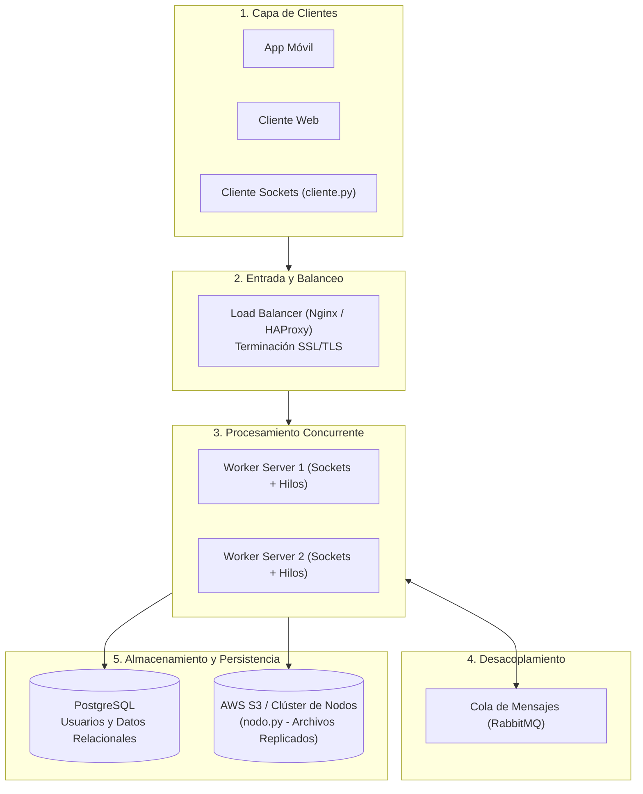

# PFO 3: Rediseño como Sistema Distribuido (Cliente-Servidor)

**Materia:** Programación sobre Redes  
**Carrera:** Tecnicatura Superior en Desarrollo de Software (IFTS Nº 29)  
**Comisión:** D - Lunes  

---

## Descripción del Proyecto

Este repositorio contiene la resolución completa de la **Práctica Formativa Obligatoria 3 (PFO 3)**. El objetivo principal de la entrega es evolucionar una arquitectura monolítica hacia un **sistema distribuido cliente-servidor**, incorporando procesamiento concurrente mediante sockets e hilos, replicación de datos con tolerancia a fallos y un esquema de alta disponibilidad.

El proyecto abarca dos componentes principales de software:

1. **Clúster de Nodos Distribuidos (`nodo.py`):** Un servicio de almacenamiento replicado de archivos que ofrece replicación activa en tiempo real, tolerancia a caídas parciales de nodos, subida en modo degradado y recuperación vía *fallback*.
2. **Servidor Worker Concurrente (`servidor_worker.py` y `cliente.py`):** Un servidor basado en sockets TCP multihilo que atiende peticiones en paralelo de múltiples clientes, protegiendo contadores y estados compartidos mediante exclusión mutua (`threading.Lock`).

---

## Estructura del Repositorio

```
.
├── nodo.py                      # Nodo parametrizado de almacenamiento distribuido (Flask/HTTP)
├── test_sistema.py              # Suite de pruebas automatizadas del clúster de nodos
├── servidor_worker.py           # Servidor TCP con sockets y Pool de Workers (ThreadPoolExecutor)
├── cliente.py                   # Cliente interactivo de terminal con framing TCP (\n)
├── test_servidor_worker.py       # Pruebas automatizadas de concurrencia, framing y workers
├── diagrama_arquitectura.mermaid # Diagrama de arquitectura distribuida en formato Mermaid
└── README.md                    # Documentación técnica del proyecto
```

---

## Explicación de la Arquitectura Distribuida

El diseño del sistema cumple con los requisitos planteados en la consigna, organizándose en 5 capas clave:



### Justificación Técnica de las Decisiones de Diseño

* **Balanceador de Carga (Nginx/HAProxy):** Actúa como punto de entrada único, distribuyendo el tráfico entre las distintas instancias de servidores workers para evitar la saturación de un solo nodo y gestionar los certificados HTTPS/TLS.
* **Sockets TCP y Multihilado (`servidor_worker.py`):** Se utiliza TCP para garantizar la entrega ordenada y sin pérdidas de mensajes. Cada conexión entrante se delega a un hilo independiente (`threading.Thread`) para atender múltiples clientes en paralelo sin bloquear el loop principal (`accept()`).
* **Sincronización y Exclusión Mutua:** Para evitar condiciones de carrera (*race conditions*) al modificar recursos compartidos (como el contador de tareas o métricas del servidor), se utiliza un candado explícito (`threading.Lock`).
* **Cola de Mensajes (RabbitMQ):** Permite desacoplar peticiones de alto consumo o procesamientos asíncronos pesados, garantizando que ninguna solicitud se pierda en momentos de alta carga.
* **Replicación Activa y Tolerancia a Fallos (`nodo.py`):**
  * **Replicación al subir:** Cuando un nodo recibe un archivo, guarda la copia local y notifica mediante peticiones HTTP `/replicate` a las réplicas configuradas.
  * **Subida degradada:** Si una o más réplicas están fuera de línea, la subida no colapsa. El nodo captura la excepción (`try/except requests.RequestException`), registra qué nodos fallaron y confirma la subida local respondiendo `200 OK`.
  * **Mecanismo de Fallback:** Si un cliente solicita un archivo a un nodo que no lo posee localmente, este lo busca automáticamente en sus réplicas antes de responder `404 Not Found`.

---

## Instrucciones de Ejecución

### Prerequisitos
* Python 3.8 o superior.
* Librerías requeridas: `flask`, `requests`, `werkzeug`.

```bash
pip install flask requests werkzeug
```

---

### 1. Probar el Clúster de Nodos Distribuidos (`nodo.py`)

Para probar el funcionamiento distribuido manualmente, abrir tres terminales y ejecutar:

```bash
# Terminal 1 - Nodo 5000
python nodo.py --port 5000 --replicas http://localhost:5001,http://localhost:5002

# Terminal 2 - Nodo 5001
python nodo.py --port 5001 --replicas http://localhost:5000,http://localhost:5002

# Terminal 3 - Nodo 5002
python nodo.py --port 5002 --replicas http://localhost:5000,http://localhost:5001
```

#### Ejecución del Test Automatizado (`test_sistema.py`)
Para verificar automáticamente la replicación, la tolerancia a fallos, la subida degradada y el fallback sin tener que levantar las terminales a mano:

```bash
python test_sistema.py
```

**Resultado esperado:**
```text
Levantando 3 nodos...
Los 3 nodos están arriba.

1) Replicación al subir
   [OK  ] la subida responde 200
   [OK  ] replicó en las 2 réplicas
   [OK  ] copia física en files_5001
   [OK  ] copia física en files_5002
2) Fallback a una réplica cuando falta local
   [OK  ] recupera el archivo desde otra réplica
3) Tolerancia a fallos (nodo caído)
   [OK  ] el archivo sigue disponible tras caer :5000
4) Subida degradada (réplicas caídas)
   [OK  ] la subida responde 200 aunque haya nodos caídos
   [OK  ] reporta las réplicas caídas
   [OK  ] guardó el archivo localmente

RESULTADO: TODO OK
```

---

### 2. Probar el Servidor Worker y Cliente por Sockets

#### A. Verificación Automatizada (`test_servidor_worker.py`)
Para verificar automáticamente el manejo de framing TCP, concurrencia de clientes simultáneos, el pool de workers y la exclusión mutua:

```bash
python test_servidor_worker.py
```

**Resultado esperado:**
```text
Levantando servidor_worker.py...
1) Prueba de respuesta PING y Framing
   [OK  ] ping responde PONG
2) Concurrencia y Pool de Workers
   [OK  ] tarea 1 de analisis procesada
   [OK  ] tarea 2 de conversion procesada
3) Estado del servidor y seccion critica (Lock)
   [OK  ] contador de clientes activos es 2
   [OK  ] contador de tareas procesadas es 2
   [OK  ] pool de workers configurado en 5

RESULTADO TEST WORKER: TODO OK
```

#### B. Ejecución Manual Interactiva
```bash
# Terminal 1: Levantar el servidor worker
python servidor_worker.py

# Terminal 2: Iniciar el cliente interactivo
python cliente.py
```

Desde el cliente vas a poder enviar tareas en formato JSON, procesar cadenas de texto o verificar el estado del servidor en tiempo real.

---

## Conclusiones
La arquitectura implementada demuestra cómo la combinación de **programación concurrente (hilos y locks)** con **sistemas distribuidos (replicación activa y fallback)** permite construir un sistema resiliente, escalable y tolerante a fallos, garantizando la continuidad del servicio incluso ante la caída parcial de nodos en la red.
